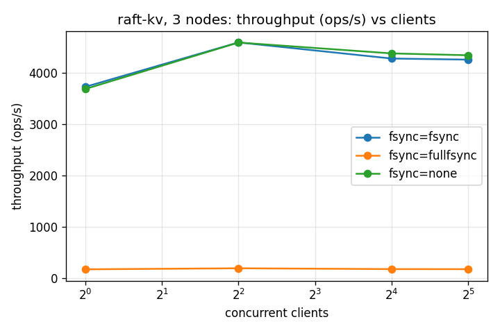
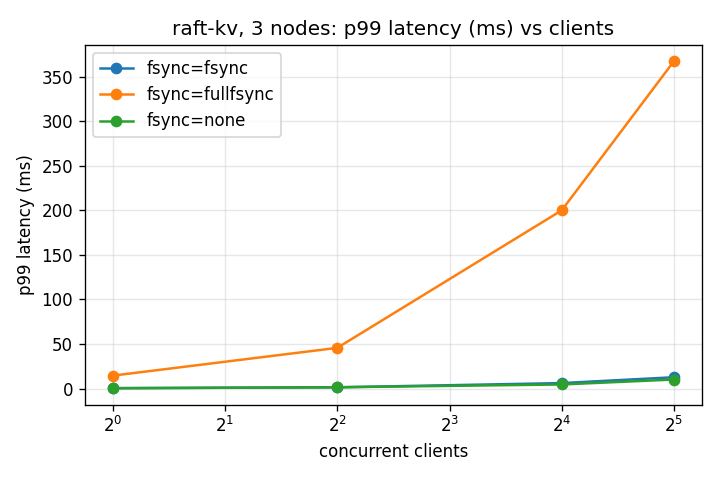

# raft-kv

A fault-tolerant, strongly consistent **distributed key-value store** built
from scratch in **C++20** on the **Raft consensus algorithm**.

---

## What it does

raft-kv runs as a cluster of nodes (separate processes) that together act
like one key-value database:

- **Put / Append / Delete / Get** on string keys, from any client.
- **Keeps working when nodes fail.** With 3 nodes, any 1 can crash (even
  `kill -9`) and the cluster keeps serving reads and writes; a new leader is
  elected automatically.
- **Never loses an acknowledged write.** Writes are replicated to a majority
  and flushed to disk before the client is told "OK".
- **Never applies a write twice**, even when clients retry after timeouts
  (exactly-once semantics).
- **Never returns stale data.** Every read reflects every write that finished
  before it (linearizability), even during network partitions.
- **Recovers from crashes** using a write-ahead log, and keeps the log small
  with snapshots.

## Why

Every serious distributed database (etcd, CockroachDB, TiKV, Consul) relies on
a consensus algorithm to stay correct when machines crash or the network
splits. This project implements that machinery end to end, the parts that are
easy to get subtly wrong:

- leader election that cannot produce two leaders,
- a commit rule that never loses committed data (Raft's "Figure 8" case),
- durable storage that survives a crash in the middle of a disk write,
- client retries that do not turn into duplicate writes,
- reads that stay correct while a stale leader still thinks it is in charge.

The goal was not just to make it work, but to **prove it works**: every claim
above is backed by tests, fault injection, and a linearizability checker.

## How it works

```
  kv_cli / bench ── KvClient (retries, follows leader hints, same seq on retry)
        │ gRPC
        ▼
 ┌──────────────────────── kv_node (one per server) ───────────────────────┐
 │  gRPC threads ──push──▶ event queue ──▶ loop thread (the only owner)     │
 │                                           │                             │
 │                       KvServer ◀──────────┤ propose writes / ReadIndex   │
 │                       StateMachine        │ apply committed entries      │
 │                       (map + dedup table) ▼                             │
 │                                         Raft   (pure logic, no I/O)      │
 │                                    ┌──────┴────────┐                    │
 │                               Transport         Storage                 │
 │                            (gRPC to peers)   (WAL, hard state, snapshot) │
 └─────────────────────────────────────────────────────────────────────────┘
```

1. **Consensus (Raft).** Nodes elect a leader. The leader appends each write
   to its log, replicates it to the followers, and commits it once a majority
   has stored it. Extras beyond basic Raft:
   - **Pre-vote** and **check-quorum**: a node cut off from the cluster cannot
     disrupt it when it comes back, and a leader in a minority steps down.
   - **ReadIndex**: reads confirm leadership with one heartbeat round instead
     of going through the log.
2. **Exactly-once writes.** Every write carries `(client_id, seq)`. The state
   machine remembers each client's last applied `seq` and skips repeats.
   Because this table is part of the replicated state, it survives leader
   changes.
3. **Durability.** Each log entry is appended to a write-ahead log with a
   CRC32 checksum and flushed to disk before it is acknowledged. After a
   crash, a half-written last record is detected and cut off. Term and vote
   are replaced atomically (temp file + rename).
4. **Snapshots.** Every 1000 entries the state (including the dedup table) is
   saved and old log entries are dropped. A follower that falls too far behind
   receives the snapshot instead.
5. **Single-threaded core.** One loop thread per node owns Raft, storage and
   the state machine; network threads only hand messages over through a
   queue. No locks inside the consensus code.

**Key design decision:** the Raft code performs no I/O and reads no clock; it
only talks to `Transport`, `Storage` and `Clock` interfaces. In production
those are gRPC, files and the system clock. In tests they are a simulated
network, an in-memory disk and a fake clock, so whole clusters run in one
process, **deterministically**, and any failing run can be replayed from its
seed.

## Tech stack

| Purpose | Technology |
|---|---|
| Language | C++20 |
| Build | CMake |
| Networking / RPC | gRPC, Protocol Buffers |
| Testing | GoogleTest, custom deterministic simulator, in-house linearizability checker (Wing & Gong search) |
| Sanitizers | AddressSanitizer + UBSan, ThreadSanitizer |
| Durability | POSIX file I/O, `fsync` / `fcntl(F_FULLFSYNC)` |
| Observability | OpenTelemetry C++ SDK (OTLP), Grafana + Prometheus (`grafana/otel-lgtm` container) |
| Benchmark plots | Python, matplotlib |

## Folder structure

```
.
├── CMakeLists.txt
├── proto/                  raft.proto (node ↔ node), kv.proto (client ↔ node)
├── inc/
│   ├── rafty/              raft.hpp, storage.hpp, types.hpp, interfaces.hpp
│   ├── kv/                 state_machine.hpp, kv_server.hpp, kv_client.hpp
│   ├── net/                gRPC transport, proto conversion, node runtime, client transport
│   ├── telemetry/          metrics.hpp (OpenTelemetry)
│   └── toolings/           simulator (sim_network, sim_cluster, kv_sim),
│                           msg_queue.hpp, lin_checker.hpp
├── src/                    raft.cpp, storage.cpp, state_machine.cpp, kv_server.cpp,
│                           kv_client.cpp, lin_checker.cpp, telemetry.cpp, net/*.cpp
├── app/                    kv_node (server), kv_cli (client), bench (load generator)
├── unittests/              Raft, storage, state machine, queue, proto, checker tests
├── integration_tests/      election, replication, recovery, KV + chaos tests
├── bench/
│   ├── results/            raw benchmark JSON (commit, hardware, fsync mode, workload)
│   └── plots/              throughput and p99 latency graphs
├── tools/grafana-suite/    run.sh + dashboards/raft.json
└── scripts/                run_cluster.sh, run_bench.sh, plot_bench.py
```

## Setup

### 1. Install dependencies (macOS, Homebrew)

```bash
brew install cmake googletest grpc protobuf abseil opentelemetry-cpp
pip3 install matplotlib          # only for benchmark plots
```
Docker Desktop is needed only for the Grafana dashboard.

### 2. Build and test

```bash
cmake -S . -B build && cmake --build build -j
(cd build && ctest --output-on-failure)        # 148 tests
```

Sanitizer builds:
```bash
cmake -S . -B build-asan -DSANITIZE=address && cmake --build build-asan -j && (cd build-asan && ctest)
cmake -S . -B build-tsan -DSANITIZE=thread  && cmake --build build-tsan -j
```

Replay a failing chaos run: `RAFT_SEED=<seed> build/integration_tests --gtest_filter='KvChaos.*'`

### 3. Run a local 3-node cluster

```bash
scripts/run_cluster.sh                         # terminal 1 (Ctrl-C stops all nodes)

P=1=127.0.0.1:50051,2=127.0.0.1:50052,3=127.0.0.1:50053
build/app/kv_cli --peers $P put x hello        # terminal 2
build/app/kv_cli --peers $P get x              # → hello
```

### 4. Crash the leader

```bash
grep leader data/n*.log                        # the highest term is the current leader
kill -9 $(pgrep -f "kv_node --id <leader id>")
build/app/kv_cli --peers $P get x              # still → hello, a new leader took over
```
Restart the killed node with the command `run_cluster.sh` printed; it
recovers from its write-ahead log and rejoins.

### 5. Grafana dashboard

```bash
tools/grafana-suite/run.sh                     # Grafana at http://localhost:3000 (admin/admin)
OTLP=localhost:4317 scripts/run_cluster.sh
```
Dashboard **raft-kv**: term and leader per node, commit index, requests/s,
p50/p99 latency.

### 6. Benchmarks

```bash
cmake -S . -B build-release -DCMAKE_BUILD_TYPE=Release && cmake --build build-release -j
scripts/run_bench.sh                           # ~5 min sweep
python3 scripts/plot_bench.py
```

## Results

### Correctness

Chaos runs inject faults in the deterministic simulator. After **every
simulated millisecond** they check Raft's safety properties: at most one
leader per term, terms and commit indices never go backwards, no two nodes
apply different entries at the same index, every new leader holds all
committed entries, and logs match.

| Scenario | Faults injected | Runs | Result |
|---|---|---|---|
| Leader election | random crashes, partitions, 10% message loss, 1-20 ms delay | 200 seeds | 0 safety violations; a leader is always re-elected after repair |
| Replication with writes | same, plus a write every 10 ms | 100 seeds | 0 violations; all logs identical after repair; no write committed twice |
| Crash recovery on real files | same, plus **torn writes** (half-written WAL records) | 30 seeds | 0 violations; every restart goes through real WAL recovery |
| KV with 4 concurrent clients | crashes, partitions, 5% node message loss, 10% request loss, 20% reply loss, snapshots every 20 entries | 30 seeds | **Linearizable: pass** on every history; every acknowledged write applied exactly once |
| Real 3-process cluster | `kill -9` the leader, restart it | manual | new leader in under a second; no data lost; node rejoins from its WAL |

Other highlights from the 148 tests:
- Torn write tested at **every byte offset** of the last log record.
- The linearizability checker is verified on hand-written **bad** histories
  (stale read, lost write, duplicated write, reordered writes) so it is known
  to catch real bugs, not just pass.
- The whole suite passes under AddressSanitizer + UBSan; concurrency code
  passes under ThreadSanitizer.

### Performance

**Setup:** 3 `kv_node` processes on one machine, 50% reads / 50% writes,
128-byte values, 1000 keys, 20 s per run, Release build.
Commit `3858c07` · Apple M4 Pro, 12 cores, internal SSD, macOS 15.7.3.
Raw data in [`bench/results/`](bench/results/).

| fsync mode | clients | throughput (ops/s) | p50 (ms) | p99 (ms) |
|---|---|---|---|---|
| `none` (not durable) | 1 | 3,689 | 0.27 | 0.35 |
| `none` (not durable) | 4 | 4,594 | 0.86 | 1.39 |
| `fsync` | 1 | 3,731 | 0.27 | 0.37 |
| `fsync` | 4 | **4,596** | 0.86 | 1.35 |
| `fsync` | 32 | 4,261 | 7.30 | 12.6 |
| `fullfsync` (durable) | 1 | 177 | 3.24 | 14.4 |
| `fullfsync` (durable) | 4 | **197** | 19.4 | 45.6 |
| `fullfsync` (durable) | 32 | 180 | 163 | 367 |

#### Throughput vs clients


#### p99 latency vs clients


### What the results mean

**1. `fsync` performs the same as no sync at all.** On macOS, `fsync` only
hands data to the SSD's volatile cache, so it costs almost nothing, and a
power loss can still lose the write. That is why raft-kv defaults to
`F_FULLFSYNC`, which forces the drive to flush its cache.

**2. True durability costs about 25× in throughput (~4,600 → ~200 ops/s).**
Three things combine:
- `F_FULLFSYNC` takes several milliseconds per call on Apple SSDs.
- All three nodes share **one** SSD, so the leader's and followers' flushes
  queue behind each other. On separate machines they would run in parallel.
- Each write is flushed on its own (no **group commit**), and the flush runs on
  the node's single loop thread, so the cluster processes one flush at a time.
  That is why the durable line stays flat as clients are added.

**3. Without durable sync, throughput levels off at ~4,500 ops/s.** Every
operation costs several gRPC round trips (writes are replicated to both
followers; reads run a ReadIndex heartbeat round), all handled by one loop
thread on the leader, with every process and client sharing one machine.
Beyond ~4 clients, more clients only add waiting time.

**4. The latency numbers are consistent (Little's law).** In a system with one
bottleneck, average latency ≈ clients ÷ throughput:

| run | clients ÷ throughput | measured p50 |
|---|---|---|
| `fsync`, 32 clients | 32 / 4,261 = 7.5 ms | 7.3 ms |
| `fullfsync`, 32 clients | 32 / 180 = 178 ms | 163 ms |
| `fullfsync`, 4 clients | 4 / 197 = 20 ms | 19.4 ms |

Requests simply queue at one bottleneck, which confirms the measurements.

**Next optimizations:** group commit (one write + one flush for all proposals
that arrive during a flush; the WAL already supports batch writes), moving the
flush off the loop thread, batching ReadIndex rounds, and running nodes on
separate machines.

## Limitations

- Fixed cluster membership (no adding or removing nodes at runtime).
- Snapshots travel in one message (gRPC's default 4 MB limit caps state size).
- No group commit or TLS yet.
- Benchmarks come from a laptop; treat the numbers as relative.
